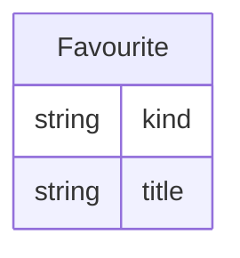

# SonosController: API design

The design of SonosController's HTTP API, with the behaviour of the real speakers and the real
Plex server that decides each part of it. Milestones 1 to 4 build on this note. The contract
between the backend and its clients stays the OpenAPI document the deployed backend serves; this
note says what that document must come to hold, and why.

Everything under "What the speakers and Plex do" was tried on 2026-11-15 against the operator's
household: Sonos S2 software 86.11, Plex Media Server 1.43, SoCo 0.32.2 and plexapi 4.18, from a
pod in the cluster. Live tests ran on the Garage speaker only, at low volume, and its queue,
position, volume and play mode were put back as found. Where something could not be tried, it
says so, and section 7 lists it.

## The decisions

| Question | Decision |
|---|---|
| Speaker events | They arrive. The backend listens on TCP 1400 with SoCo's own listener and advertises the address of a LoadBalancer Service of its own. Speaker addresses are configuration; a pod cannot discover speakers by multicast. |
| Rooms and groups | A **speaker** in the API is a room. A room's hidden devices (surrounds, the second half of a pair) are not shown. A group is the set of rooms that play together; playback and queue calls on any member go to the group's coordinator. |
| Queueing | Through the Plex service linked in Sonos, with addresses the backend builds itself. SoCo's `PlexPlugin` is not used: it starts multicast discovery, which fails in a pod. |
| Order of an artist | The Plex service gives the newest album first. The backend does not rely on that: it reads the albums from Plex, sorts them by release date, and queues them album by album. Newest first is the default, since that is what the speaker does today; oldest first is one request field. |
| Shuffle | The speaker's own shuffle mode. Play always sets the mode back to normal before it queues, so Play is in order whatever was shuffled before. |
| Large playlists | The speaker refuses a playlist of 12,019 tracks and queues nothing. The library shows playlists of 1 to 1,000 tracks. |
| Long work | Queueing music runs as a task (`202` and a task id). Every other call answers directly. |
| Favourites | Stored with Plex's `guid`, the item's rating key as a shortcut, and its title as a last resort. |
| Artwork | One endpoint, keyed by an artwork id, at a requested square size: JPEG, or LVGL 9's binary image in RGB565 with ordered dithering, written by IoT Support's `LVGLImage.py`. |
| Events | Small server-sent events that name what changed. A client fetches the state itself. Every connection receives every event; there is nothing to subscribe to. |
| State | The backend mirrors the speakers' state in memory, fed by their events, and stores only favourites. |

## 1. What the speakers and Plex do

### 1.1 Event notifications reach a pod, through a LoadBalancer

A speaker delivers UPnP `NOTIFY` requests to the callback address given in `SUBSCRIBE`. Three
callback addresses were tried from a pod, each with a listener on port 1400:

| Callback address | Result |
|---|---|
| The address of the pod's LoadBalancer Service | The first `NOTIFY` arrived 40 ms after `SUBSCRIBE`. Its source address was the speaker's own. |
| The DNS name of that Service | Arrived the same way: the speaker resolves names itself. |
| The pod's own address | Nothing arrived. The pod network is not reachable from the speakers. |

With SoCo's listener advertising the LoadBalancer address, subscriptions to all five services
delivered their first event at once and kept delivering for the whole test session:

- `AVTransport`: transport state, play mode, the current track's number and metadata, the number
  of tracks, the next track, and the actions the speaker allows now.
- `RenderingControl`: volume and mute, per channel; `Master` is the room's volume.
- `GroupRenderingControl`: the group's volume and mute.
- `Queue`: an `update_id` that changes on every change to the queue, a change of play mode
  included.
- `ZoneGroupTopology`: the whole household's layout.

What follows from the detail:

- **The speaker grants the lease asked**, and 24 hours (`Second-86400`) when none is asked. SoCo
  renews at 85% of it. The backend asks 5 minutes, for the reason below.
- **A subscription whose callback no longer answers holds up the speaker's notifications to every
  subscriber, until its lease runs out.** With one such subscription in place, the callback of a
  stopped KubeCoder environment, about a third of the Garage's volume changes reached the backend
  2.5 to 15 s late, on and off, and the rest at once; the delays ended with its lease. Once a
  delivery to it has failed, the speaker answers its `UNSUBSCRIBE` with 412 and keeps it. So only
  the lease ends a subscription its subscriber left behind (a killed process, a stopped
  environment): the backend asks 5 minutes, and a session that subscribes unsubscribes before it
  ends (`docs/change-discipline.md`, the live rules).
- **The events Service routes to the pod before the pod is ready.** The backend subscribes while
  it starts, before its readiness check passes, and SoCo binds its listener before the first
  `SUBSCRIBE`. A Service that waits for readiness drops the speakers' first notifications, and
  then the backend's own subscriptions are the ones whose delivery failed: after one deploy, no
  change reached the backend for 3.5 minutes. The deployment's events Service sets
  `publishNotReadyAddresses`.
- **SoCo advertises the port it binds.** It has an advertised address (`EVENT_ADVERTISE_IP`, which
  also takes a name) but no advertised port. So the Service's port and the container's port are
  the same number, 1400.
- **Events are partial.** Some `AVTransport` events carry only the allowed actions, and most leave
  them out. The backend merges each event into the state it holds.
- **Events come in bursts.** Queueing track by track produced 17 `Queue` events in two seconds.
  The backend coalesces what it passes on (section 4).
- **Events can arrive late.** On the Garage some notifications came within 40 ms of the change
  and others up to 44 s after it, on and off, with a callback by name and by address alike. The
  speaker folds what changed meanwhile into one notification, so nothing is lost. The cause is
  not established.
- **Nothing reports the elapsed time.** There is no event for it, so showing progress would mean
  polling. Seeking is left out of the project, and the API has no elapsed time.

### 1.2 A room of several devices, and a group of rooms

The household has two rooms. The Garage is one device. Zitkuil is three: a soundbar and two
surround speakers.

- **A room with several devices is one visible device.** The topology lists the soundbar as
  visible and both surrounds as invisible members of the same group, all three under the room's
  name. The visible device is the room's coordinator. It carries the room's volume, and it is the
  only one that takes commands. A stereo pair is presented the same way: one visible device, one
  hidden.
- **A group of rooms** is a zone group with more than one visible member. One of them is the
  coordinator: it holds the queue and the transport, and the others follow it. Each room keeps its
  own volume, and the group has a volume that moves all of them in proportion.
- **A room alone is a group of one.** The group volume calls (`SnapshotGroupVolume`,
  `SetGroupVolume`, `SetRelativeGroupVolume`) and the group's events work on the Garage alone,
  and move the room's volume with them. A client can therefore always use the group volume.
- **Joining and leaving** are commands to the room that moves: it joins by setting its transport
  to `x-rincon:<coordinator's id>`, and leaves with `BecomeCoordinatorOfStandaloneGroup`.
  **This was not tried.** A group needs a second room, and live tests may use the Garage only. It
  is SoCo's `join` and `unjoin`, unchanged for years, and it is the first thing to check when the
  speakers screen is built (section 7).

### 1.3 Queueing through the Plex service

The Plex service in this household is Sonos service 212 (service type 54279 = 212 × 256 + 7),
read from the speaker's `ListAvailableServices` by its name. An item of the library is addressed
as `<server's machine identifier>:<library section id>:<rating key>:<kind>`. Wrapped as
`x-rincon-cpcontainer:<prefix><that id, URL-encoded>?sid=212&flags=8300&sn=<n>` with a small
DIDL document, it goes onto the queue with `AddURIToQueue`, and the speaker fetches the tracks
and their details from the service.

| Item | Prefix | One call | Measured |
|---|---|---|---|
| Track | `10036020` | 1 track | 1.1 s |
| Album | `1004206c` | the album, in disc and track order | 0.4 to 0.6 s for 11 tracks |
| Artist | `1005004c` | every track of the artist | 3.2 s for 287 tracks, 4.9 s for 1,243 |
| Playlist | `1006206c` | the playlist, in its own order | 1.5 s for 148 tracks |

Every queue entry came out complete: title, artist, album, duration and artwork.

- **The account number does not matter.** `sn=0`, `1`, `9` and the real one all queued, and the
  speaker wrote the real one into every queue entry. The backend need not find it, which is as
  well: `/status/accounts` lists no accounts on this software.
- **A queue entry names its Plex track.** Its address is
  `x-sonos-http:<machine>%3a<section>%3a<rating key>%3atrack.mp3?…`, so the backend can tell a
  Plex track in the queue and read its rating key.
- **`AddMultipleURIsToQueue` takes 16 items a call**, tracks or album containers. The metadata
  documents are joined with plain spaces, unencoded. Encoding the spaces inside them makes the
  speaker accept the addresses and drop every title.
- **Adding tracks one by one is slow.** The speaker fetches each track's details from the
  service, about 0.33 s a track however they are batched. A container costs about 0.01 s a track.
  So the backend queues containers and never lists of tracks.
- **SoCo's `PlexPlugin` cannot be used from a pod.** Its service lookup goes through
  `discovery.any_soco()`, a multicast search. It also needs a plexapi object for every item. The
  backend builds the address and the DIDL itself, about twenty lines, and sends them through
  SoCo's `avTransport` service.

### 1.4 The order of an artist

**The Plex service queues an artist newest album first**, each album in disc and track order:
for an artist with eleven albums the queue ran 2016, 2011, 2007, 2004, 2003, 2002, 2001, 2000,
1997, 1994, 1993. Plex's own artist page lists albums the same way. So what the operator hears
today when they play an artist from the Sonos app is release-year order, newest first.

That order is the choice of Plex's cloud service and is written down nowhere, so the backend
does not rest on it. It builds the order itself:

1. Read the artist's albums from Plex:
   `/library/sections/<id>/all?type=9&artist.id=<rating key>&sort=originallyAvailableAt`.
   The server sorts correctly, `:desc` included, in under 10 ms.
2. Order by release date, then title, then rating key. Albums without a date go last: 5 of the
   853 have none.
3. Queue the first album with `AddURIToQueue` and start playing. Queue the rest as album
   containers with `AddMultipleURIsToQueue`, 16 a call.

| Artist | Albums | Tracks | Whole queue built in | Music starts after |
|---|---|---|---|---|
| Medium | 12 | 287 | 5.7 s | about 0.5 s |
| The largest | 76 | 1,243 | 33 s | about 0.5 s |

The queue came out in exactly the order asked for, and within each album in Plex's disc and
track order.

**Newest first is the default**, because that is how the speaker plays an artist today and the
operator asked for that to stay. Oldest first is the same code with the sort reversed, and the
request carries the choice (`order`, section 3.4).

### 1.5 Shuffle

The speaker's shuffle mode (`SHUFFLE_NOREPEAT`) does more than pick tracks at random:

- **The queue is presented in play order.** With shuffle on, browsing the queue returns the
  shuffled order and the current track's number counts along it: 1, 2, 3 on each Next. A queue
  screen that lists the queue as the speaker gives it shows what plays next, shuffled or not.
- **Switching back to normal restores the original order**, with the current track at its
  original place.
- **The mode is the speaker's and it stays.** It survived clearing the queue and queueing
  something else. A Play that did not reset it would play shuffled.
- **Mode first, then music.** With shuffle already on, newly queued tracks land at random places,
  and the first track differed on each of three tries. Setting shuffle on a loaded queue instead
  keeps the current track first.
- **Appending while shuffle is on** mixes the new tracks into the rest of the shuffled order.

So:

- **Play** clears the queue, sets the mode to `NORMAL`, queues, and plays from the first track.
- **Shuffle** clears the queue, sets `SHUFFLE_NOREPEAT`, queues the item as **one** container (for
  an artist the artist container, so every track is there before the first is drawn), and plays
  from the first track of the shuffled order.
- **Add to queue** appends and leaves the mode alone.

Shuffling in the backend instead, and queueing tracks in that order, is ruled out by 1.3: 287
tracks would take a minute and a half.

### 1.6 A very large playlist, and which playlists are shown

Plex shows nine audio playlists: four the operator made (4 to 148 tracks) and five that Plex
makes itself. Four of those five are empty; the fifth holds all 12,019 tracks.

- **The speaker refuses the 12,019-track playlist.** `AddURIToQueue` fails after about ten
  seconds with UPnP error 800 and queues nothing. Since Play clears first, a failed Play leaves an
  empty queue.
- **A container of 1,243 tracks is fine** (4.9 s). The limit looks like the speaker's patience,
  about ten seconds, more than a count, so the safe size is well under what ten seconds can
  fetch.
- **A queue of 1,243 entries is no burden.** Browsing returns at most 1,000 entries a call
  (1.0 s), 100 entries take 0.12 s, the size is one call (10 ms), and clearing it took no
  noticeable time.
- **Plex's automatic playlists cannot be told from the operator's by a flag.** They are smart
  playlists (`smart=1`), and so is any smart playlist the operator makes.

**The library shows a playlist when it holds 1 to 1,000 tracks** (`PLAYLIST_MAX_TRACKS`). That
drops the empty ones and the one the speaker cannot take, by what they are and not by their
names. Queueing a larger playlist is refused before the speaker is asked. Playing the whole
library at random is not in what is agreed; if it is wanted later, the way is a random draw of
album containers, not that playlist.

### 1.7 Whatever else plays

A radio stream was started on the Garage for a few seconds.

- The transport address is the stream, not the queue. The queue stays as it was and is still
  there afterwards.
- The title is what the stream reports, the artist is the station, the album is empty and the
  duration is zero.
- The speaker allows `Play` and `Stop` only: no `Pause`, no `Next`. `Next` fails with UPnP
  error 701.
- A Plex track allows `Play`, `Pause`, `Stop` and `Next`, and `Previous` from the second track
  on.

So the playback state carries the actions the speaker allows now, and a client offers only
those. Pause stops the stream when the speaker has no pause.

### 1.8 Identifiers in Plex

- **The rating key** addresses an item everywhere in Plex's API and in the queue. It is the
  server's database id: it stays through an ordinary scan and a metadata refresh, and changes
  when Plex sees the item as new (files moved or renamed, an item removed and added again, a
  library recreated).
- **The `guid`** is `plex://artist/…`, `plex://album/…` or `plex://track/…` for an item Plex has
  matched: 93 of the 94 artists and 827 of the 853 albums. It names the item in Plex's own
  catalogue and comes back when the item is added again.
- **An unmatched item's `guid` is `local://<rating key>`**: the rating key again, and no more
  stable than it.
- **A lookup by `guid` works for music**: `/library/sections/<id>/all?type=<8|9|10>&guid=<guid>`
  returned the one item for an artist, an album and a track, in under 10 ms.
- **A `guid` is not unique.** Seven album `guid`s occur twice (the same release in the library
  twice).
- **A playlist** has a rating key and a `guid` of its own (`com.plexapp.agents.none://<uuid>`).
  Playlists live outside the library section, so a scan does not touch them.
  `/playlists?guid=<guid>` finds one by its `guid`.

Rescans were not provoked on the operator's library. What a rating key and a `guid` survive is
from Plex's forum and the tools that repair references after a rescan, which match on `guid`
first and title second. Section 5 stores a favourite accordingly.

### 1.9 Artwork

- **Plex gives every item a `thumb` path**, `/library/metadata/<rating key>/thumb/<stamp>`, and a
  playlist a `composite`, `/playlists/<rating key>/composite/<stamp>`. A track's `thumb` is its
  album's, so an album's tracks share one picture. One album of 853 and two artists of 94 have
  none.
- **The source is large**: an album cover came as a 1000 × 1000 JPEG of 839 KB.
- **Plex resizes**: `/photo/:/transcode?url=<thumb>&width=W&height=H&minSize=1&upscale=1` answers
  a JPEG in about 65 ms (`format=png` gives PNG). With `minSize=1` the picture covers the box and
  keeps its shape; without it, it fits inside. Neither crops, so a square needs a crop
  afterwards.
- **Plex ignores the stamp.** A `thumb` path with any stamp answers the item's picture as it is
  now.
- **The speaker serves artwork for whatever it plays**, at `/getaa?…` on its own port: a
  300 × 300 JPEG for a Plex track. This is the only source for something that is not from Plex.
  It goes on serving a track's picture after the track has stopped being the one loaded.
- **IoT Support's converter** (`backend/app/utils/lvgl/LVGLImage.py`) is LVGL's own
  `scripts/LVGLImage.py`, kept verbatim. It writes LVGL 9's binary image: a 12-byte header
  (magic `0x19`, colour format, flags, width, height, stride, reserved; little-endian) and then
  the pixels. It supports RGB565 (`0x12`). **It does not dither**, and IoT Support uses it for
  ARGB8888 only. Its RGB565 path from a PNG truncates, and loses a level through its
  premultiply step.
- **Dithering before the converter** works: resize, dither onto 5-6-5 levels, pack as
  little-endian RGB565, hand the bytes to `LVGLImage.set_data(ColorFormat.RGB565, w, h, data)`
  and write with `to_bin(…, CompressMethod.NONE)`. Ordered dithering with an 8 × 8 Bayer matrix,
  in numpy:

| Size | Resize | Dither and pack | Bytes (12 + 2 × w × h) |
|---|---|---|---|
| 80 × 80 | 3 ms | under 1 ms | 12,812 |
| 160 × 160 | 3 ms | 1 ms | 51,212 |
| 400 × 400 | 5 ms | 4 ms | 320,012 |

  Against the same picture rounded to 5-6-5, the dithered one is four times closer to the
  source in local average colour, which is the banding that dithering is there to remove. Error
  diffusion (Floyd–Steinberg) took 560 ms for 240 × 240 in a Python loop and is not worth it.

## 2. The backend around the API

- **The backend mirrors, and does not own, the speakers' state.** A singleton service holds, per
  speaker, what the events report, and re-reads a speaker in full when it subscribes or
  subscribes again. A `GET` answers from this mirror, and asks Plex only for the picture of a
  Plex track (3.7). The mirror changes on the speakers' events and on its own reads of the
  layout, never on a command: after a command a `GET` answers the old state until the speaker's
  event arrives (1.1). Nothing of it is stored: after a restart the backend reads the speakers
  again, and the music has played on.
- **Speakers are found from configured addresses.** `SONOS_SEED_HOSTS` lists one or more
  speakers; any one that answers gives the household's layout and the addresses of the rest.
- **The subscriptions heal themselves.** SoCo renews them. On a failed renewal, a speaker that
  restarted or a changed address in the topology, the backend subscribes again, re-reads the
  state and sends the events of what the read changed. A speaker that restarts forgets its
  subscriptions without a word, so the backend also reads the layout itself, every 10 seconds
  and at once after a failed renewal: that read finds a restart by the device's boot sequence
  number, and a room that did not answer before. When no speaker answers at the app's start, the
  app starts with an empty mirror, which fills once one does. This is one background service on
  the template's lifecycle hooks, and the reason the app runs as one replica.
- **Plex is read directly**, with `PLEX_URL` and `PLEX_TOKEN`, for the library, for the order of
  an artist, for favourites and for artwork. The token also sees a server shared by someone
  else; the configured address settles which server is meant.
- **Text is Unicode NFC.** Every string from Plex or a speaker is normalised before it leaves the
  API. The display's fonts hold composed characters only.
- **Readiness**: the Sonos and the Plex service each register a check of their own, neither
  critical (READY-1, READY-2). Sonos's passes when a speaker answers, Plex's when Plex answers
  and has the music library. The app serves favourites without either.
- **Failures** of a speaker or of Plex are `ExternalServiceException`, a `502` in the template's
  envelope (BE-3). Its message is the client's own wording, which names no address and never the
  token.

## 3. The API

Conventions that hold for every endpoint:

- Paths are under `/api`. Errors use the template's envelope and every endpoint documents its
  error statuses (API-5).
- **Identifiers.** A favourite is the app's own record and has the app's integer key (API-1). A
  speaker and a library item are not the app's records: they are addressed by the id their own
  system gives them, the speaker's Sonos id (`RINCON_…`) and Plex's rating key, both as strings.
  Neither is a name or anything a user chose. An artwork id is issued by the backend and opaque.
- **Lists that can be long are paged** with the template's `PaginationQuerySchema`: `page`,
  `per_page` (at most 100), `sort_by`, `sort_dir`, answered as `data` and `meta` (API-4). The
  display asks for 100.
- **A status is a `Literal`** in the schema (STATUS-1). The values are given below.
- **A call that changes something answers `204`** unless it says otherwise. What changed arrives
  as an event.

### 3.1 Speakers and groups

| Endpoint | Does |
|---|---|
| `GET /api/speakers` | Every room, as `data`. Not paged: a household's rooms are few. |
| `GET /api/speakers/{speaker_id}` | One room. |
| `PUT /api/speakers/{speaker_id}/group` | Body `{"speaker_id": "<a member of the group to join>"}`. This room joins that group. |
| `DELETE /api/speakers/{speaker_id}/group` | This room leaves its group and plays alone. |

```json
{
  "id": "RINCON_…",
  "name": "Garage",
  "model": "Play:3",
  "volume": 22,
  "muted": false,
  "group": {
    "coordinator_id": "RINCON_…",
    "member_ids": ["RINCON_…"],
    "volume": 22,
    "muted": false
  }
}
```

- A room alone has a group with itself as the only member (1.2).
- `id` is what a display stores as its choice. It is the device's own and does not change with
  the room's name or address.
- Hidden devices are not listed (1.2). The list is sorted by name, and empty while no speaker
  answers.
- An unknown `speaker_id` is a `404` with code `SPEAKER_NOT_FOUND`, here and below, in a join's
  body as in its path.
- **A join or a leave goes to the room in the path alone** (1.2). A join's body names the group by
  any of its rooms, its coordinator or another, and the group keeps its coordinator; a room alone
  is a group of one, so this is also how two rooms start a group. A body that is not an object
  holding `speaker_id`, a string, and nothing else is a `400`.
- A join to the group the room already plays in, and a leave by a room alone, send the speakers
  nothing and answer `204`. Which group a room plays in is read from the mirror (2), and the new
  groups arrive as `speakers_changed`, with `volume_changed` for every room whose group changed
  and `playback_changed` for every room that now plays something else (4).

### 3.2 Playback

Every endpoint under a speaker acts on the speaker's group: the backend sends the command to the
group's coordinator.

| Endpoint | Does |
|---|---|
| `GET /api/speakers/{speaker_id}/playback` | What plays, and what can be done. |
| `POST /api/speakers/{speaker_id}/playback/play` | Play or resume. |
| `POST /api/speakers/{speaker_id}/playback/pause` | Pause. Stops, when the speaker offers no pause (1.7). |
| `POST /api/speakers/{speaker_id}/playback/next` | Next track. |
| `POST /api/speakers/{speaker_id}/playback/previous` | Previous track. |

```json
{
  "state": "playing",
  "source": "queue",
  "actions": ["play", "pause", "next", "previous"],
  "shuffle": false,
  "queue_position": 3,
  "queue_length": 11,
  "track": {
    "title": "…",
    "artist": "…",
    "album": "…",
    "duration_ms": 241000,
    "artwork_id": "…",
    "track_id": "37063"
  }
}
```

- `state`: `playing`, `paused`, `stopped` or `buffering` (the speaker's `TRANSITIONING`).
- `source`: `queue`, `radio`, `line_in`, `tv` or `other`, from the transport address.
- `actions`: what the speaker allows now, of `play`, `pause`, `next`, `previous`; `pause` is
  there when the speaker allows a pause or a stop (1.7). A command that is not among them is a
  `409` with code `ACTION_NOT_AVAILABLE`. The check reads the mirror, so a command the speaker
  stopped allowing before its event arrived goes to the speaker, which refuses it: a `502`.
- `queue_position` is 1-based and `null` when the source is not the queue, and for an empty
  queue. `queue_length` is `null` when the source is not the queue.
- `track` is `null` when nothing is loaded. For a radio stream the title is what the stream
  reports as playing, the station until it reports anything, and the artist is the station.
  `album`, `duration_ms` and `artwork_id` are `null` when the source gives none, as a radio
  stream does. `track_id` is the Plex track when the queue entry is one (1.3), else `null`.
- There is no elapsed time (1.1) and no repeat.

### 3.3 Volume

| Endpoint | Does |
|---|---|
| `POST /api/speakers/{speaker_id}/volume` | Sets this room's volume. |
| `POST /api/speakers/{speaker_id}/group/volume` | Sets the group's volume. |

The body holds exactly one of `volume` (0 to 100) and `delta` (−100 to 100), and may hold
`muted`: `{"delta": 0, "muted": true}` mutes and leaves the volume. Anything else is a `400`:
`muted` alone, both of the two or neither, a value out of range or of another JSON type, a field
that is not one of the three. The answer is `200` with `{"volume": …, "muted": …}` as the speaker
gives them after the change, so a client can show it at once. The current values are in the
speaker (3.1).

- `delta` is the speaker's own relative step. Two displays that each press "louder" both count,
  where two absolute values would overwrite each other.
- The now-playing bar uses the group volume: for a room alone it is the room's volume, and for a
  group it moves every room, as the Sonos app's main slider does. The room's own volume is for
  the speakers screen.

### 3.4 The queue

| Endpoint | Does |
|---|---|
| `GET /api/speakers/{speaker_id}/queue` | The queue, paged. |
| `POST /api/speakers/{speaker_id}/queue` | Play, shuffle or add an item of the library. Answers `202` with a task. |
| `DELETE /api/speakers/{speaker_id}/queue` | Clears the queue. |

**Reading.** `sort_by` is `position`, the only value. `locate=current` answers the page that
holds the current track, whatever `page` says; `meta.page` tells which page it is.

```json
{
  "data": [
    {
      "position": 1,
      "title": "…",
      "artist": "…",
      "album": "…",
      "duration_ms": 241000,
      "artwork_id": "…",
      "track_id": "37061"
    }
  ],
  "meta": { "page": 1, "per_page": 100, "total": 11, "total_pages": 1, "sort_by": "position", "sort_dir": "asc" },
  "current_position": 3
}
```

- The queue is listed as the speaker gives it. With shuffle on, that is the order in which it
  will play (1.5).
- `current_position` is `null` when the source is not the queue.
- `artwork_id` for the Plex tracks of a page comes from one Plex call for the whole page
  (`/library/metadata/<key>,<key>,…`, 21 ms for four items; a key Plex does not have is left out
  of the answer). An entry that is not from Plex has `null`.
- A page of 100 costs the speaker 0.12 s (1.6).

**Queueing.**

```json
{ "kind": "artist", "item_id": "37059", "action": "play", "order": "newest_first" }
```

- `kind`: `artist`, `album`, `track` or `playlist`. `item_id`: its rating key.
- `action`:
  - `play` replaces the queue and plays it in order;
  - `shuffle` replaces the queue and plays it shuffled;
  - `add` appends and changes nothing else: not the mode, not what plays.
- `order`: `newest_first` (the default) or `oldest_first`. It is read for an artist with `play`
  or `add`, and ignored otherwise.

The endpoint checks the speaker and the item, then starts a task and answers `202` with the
template's `TaskStartResponse` (API-2): a large artist takes 33 seconds to queue, and a display
gives a request five. The task does what 1.4 and 1.5 found:

| Action | Steps on the coordinator |
|---|---|
| `play` | Clear. Set `NORMAL`. Queue the first container. Play from the first track. Queue the rest. |
| `shuffle` | Clear. Set `SHUFFLE_NOREPEAT`. Queue the item as one container. Play from the first track. |
| `add` | Queue the containers at the end. |

- An artist with `play` or `add` is its album containers in release order, the first alone and
  the rest 16 a call. Everything else is one container.
- Music starts about half a second into the task. The queue grows behind it, and each step
  reaches the clients as `queue_changed`.
- A task that fails reports it through the template's task events, to every connection. A
  display watches for the id it was given and shows the error. A failed `play` leaves the queue
  as far as it got, which may be empty.
- Refused before any task starts: an item Plex does not have (`404`, `ITEM_NOT_FOUND`), and a
  playlist over `PLAYLIST_MAX_TRACKS` or with no tracks (`409`, `PLAYLIST_NOT_PLAYABLE`).

Playing from a chosen place in the queue, removing one entry and reordering are not in what is
agreed and are left out.

### 3.5 The library

Read from Plex on each request; the backend keeps no copy. The whole artist list takes Plex
140 ms.

| Endpoint | Gives |
|---|---|
| `GET /api/library/artists` | Artists, paged, by sort title. |
| `GET /api/library/artists/{artist_id}` | One artist. |
| `GET /api/library/artists/{artist_id}/albums` | The artist's albums, paged. `sort_by=release` (default) or `title`; `sort_dir` defaults to `desc`, newest first, the order Play uses. |
| `GET /api/library/albums/{album_id}` | One album. |
| `GET /api/library/albums/{album_id}/tracks` | The album's tracks, paged, in disc and track order. |
| `GET /api/library/playlists` | The playlists that can be played (1.6), paged, by title. |
| `GET /api/library/playlists/{playlist_id}` | One playlist. |

An artist, an album, a track and a playlist:

```json
{ "id": "37059", "title": "…", "index_letter": "R", "artwork_id": "…", "favourite_id": null }
```

```json
{ "id": "37060", "title": "…", "artist_id": "37059", "artist": "…", "year": 2001,
  "track_count": 11, "artwork_id": "…", "favourite_id": 4 }
```

```json
{ "id": "37061", "title": "…", "artist": "…", "disc": 1, "number": 1, "duration_ms": 241000,
  "artwork_id": "…" }
```

```json
{ "id": "43830", "title": "…", "track_count": 148, "duration_ms": 37610000, "artwork_id": "…",
  "favourite_id": null }
```

- `index_letter` is the letter the artist files under: `A` to `Z` from the sort title with
  accents folded, and `#` for anything else. The A–Z bar jumps to the first row with the letter,
  and the display folds no accents itself.
- `favourite_id` is the favourite that marks this item, or `null`. The toggle deletes that
  favourite or creates one.
- `year` is `null` for an album without a date.
- A track's `artist` is the track's own where Plex has one, as on a compilation.
- The tracks of a playlist are not listed. The display plays a playlist and does not open it.
- There is no search.

### 3.6 Favourites

| Endpoint | Does |
|---|---|
| `GET /api/favourites` | The favourites, paged. `sort_by=created_at` (default) or `title`. |
| `POST /api/favourites` | Body `{"kind": "album", "item_id": "37060"}`. Marks the item. `201` with the favourite; `200` with the existing one when it is marked already. |
| `DELETE /api/favourites/{favourite_id}` | Removes the mark. |

```json
{
  "id": 4,
  "kind": "album",
  "item_id": "37060",
  "title": "…",
  "subtitle": "…",
  "artwork_id": "…",
  "available": true,
  "created_at": "2026-11-15T10:00:00Z"
}
```

- `kind`: `artist`, `album` or `playlist`.
- `item_id` is where the item is in Plex **now**: what to pass to the queue and the library. It
  is `null`, and `available` is `false`, when Plex no longer has the item. The favourite is kept
  and shown as unavailable, and comes back when the item does.
- `subtitle` is the artist for an album, and `null` otherwise.
- Marking an item twice is not an error: two displays may press the same star.
- Section 5 has the record and how it finds its item again.

### 3.7 Artwork

`GET /api/artwork/{artwork_id}?size=<pixels>&format=<jpeg|lvgl>`

- **An artwork id names one picture.** Every object above that has a picture carries its
  `artwork_id`, and `null` when it has none. Two objects with the same picture carry the same id,
  as an album and its tracks do. When the picture changes, the id does. A client can therefore
  keep a picture by id and size for as long as it likes, and the answer says so
  (`Cache-Control: public, max-age=31536000, immutable`).
- **The id is the backend's to shape.** For a library item it encodes Plex's `thumb` or
  `composite` path with its stamp (1.9). For something that plays from another source it names
  the group's coordinator and a digest of the track's address and of its picture's, and the
  picture is the one that speaker serves (`/getaa`), answered only while that track is the one
  the coordinator has loaded.
- **`size`** is the side of a square in pixels. The picture is scaled to cover the square and
  cropped at the centre.
- **`format=jpeg`** (the default), 16 to 1024 pixels: `image/jpeg`. This is the ordinary image,
  for any client.
- **`format=lvgl`**, 16 to 480 pixels: the form the display draws without decoding. It is LVGL
  9's binary image: the 12-byte header, then RGB565 pixels, little-endian, uncompressed, no
  alpha, dithered, at exactly `size` × `size`, as `application/octet-stream` with
  `Content-Length`. The display asks for 400, 160 and 80. This is the one part of the API made
  for the device.
- **An unknown id is a `404`** with code `RECORD_NOT_FOUND`, and so is a speaker's picture once
  its track is no longer loaded. A client shows its placeholder. Plex ignores the stamp (1.9), so
  the id of a Plex picture that has since changed answers the picture as it is now.
- **A source that fails** (Plex, the speaker, or bytes that are no picture) is a `502`.

How it is made: Plex resizes its own picture first (`/photo/:/transcode` with `minSize=1`),
Pillow scales what it has to cover the square and crops it at the centre, and for `lvgl` the
backend applies the ordered dither of 1.9 and writes the file
with IoT Support's `LVGLImage.py`, copied verbatim to `backend/app/utils/lvgl/` as IoT Support
keeps it. That module imports `pypng` and `lz4` when it loads, so both are dependencies, with
Pillow and numpy. The whole conversion is under 15 ms, so a cache of finished pictures is a
convenience and not a need: the backend keeps the ones used last in memory, 16 MB of them, by id,
size and format, and checks that a speaker's picture is still current before it looks there.

## 4. Events

The stream is the template's: `GET /api/sse/stream?request_id=<id>`, a `ready` event first, then
unnamed messages `{"type": …, "payload": …}`, and a heartbeat comment when idle. It has no event
ids and no replay.

| `type` | `payload` | A client fetches |
|---|---|---|
| `speakers_changed` | `{}` | `GET /api/speakers`: a room appeared or went, was renamed, joined or left a group. |
| `volume_changed` | `{"speaker_id": …}` | `GET /api/speakers/{speaker_id}` |
| `playback_changed` | `{"speaker_id": …}` | `GET /api/speakers/{speaker_id}/playback` |
| `queue_changed` | `{"speaker_id": …}` | `GET /api/speakers/{speaker_id}/queue`, when it shows the queue |
| `favourites_changed` | `{}` | `GET /api/favourites` |
| `task_event` | the template's | Nothing: it reports the queueing task (3.4). |

- **Events name what changed and carry no state.** A client fetches, so there is one way to read
  each state and nothing to keep in step.
- **Every connection receives every event.** The app has no users to tell apart, so each event
  is sent to the local-admin target, which every connection is; this is not a broadcast in the
  sense of SSE-2. A client ignores the speakers it does not show. There are no channels and no
  subscriptions to renew.
- **Group events go out for every member**, since each display follows its own room.
- **After `ready` a client fetches what it shows.** That covers the first connection and every
  reconnection, so the backend sends no snapshot.
- **The backend coalesces**: at most one event of a type for a speaker in 250 ms, with the last
  one always sent. A burst of 17 queue changes (1.1) becomes a handful.
- The events come from the speakers' own notifications. A change made in the Sonos app reaches
  a display the same way as one made on another display.

## 5. The data model

**Scope.** What the backend stores: the household's favourites. Concept model.

**Entities.**

*Favourite.* A Favourite is an individual mark the household has put on one artist, one album or
one playlist of the Plex library, so that it shows on every display's home screen. It records
which item is meant, in a way that finds the item again after Plex has rescanned its library.
Samples: the artist "Radiohead"; the album "Amnesiac" by Radiohead; a playlist the operator made;
an album that has since been removed from Plex and is kept as unavailable; one of two copies of
the same release that the library holds twice. Notes: a Favourite is not the item itself, which
lives in Plex and is never copied. A track cannot be a Favourite. A Favourite belongs to the
household, not to a display or a person. Also called: none.

**Diagram.**



**Assertions.**

1. A Favourite marks one item of the Plex library, which is an artist, an album or a playlist.
2. No two Favourites mark the same item.
3. A Favourite whose item Plex no longer has remains a Favourite.

**Sample instances.**

| kind | title | parent title | guid | rating key |
|---|---|---|---|---|
| artist | Radiohead | | `plex://artist/5d07…` | 37059 |
| album | Amnesiac | Radiohead | `plex://album/5d07…` | 37060 |
| album | an unmatched album | its artist | `local://37246` | 37246 |
| playlist | a playlist the operator made | | `com.plexapp.agents.none://e2…` | 43919 |
| album | an album since removed from Plex | its artist | `plex://album/5d07…` | 41210 |

**Decisions and open questions.**

1. **What is stored to find the item again**, from 1.8: its kind, Plex's `guid`, the rating key
   it had when last seen, its title, and for an album its artist's title. The logical model, with
   keys and types, is the favourites slice's.
2. **How the item is found**, in this order, stopping at the first that succeeds:
   1. by the stored rating key, accepted when the item there has the stored `guid`. This is one
      Plex call for all favourites together, and the usual case;
   2. by `guid`, unless it is a `local://` one. Of several hits, the one whose title and artist
      match;
   3. by kind, title and artist's title, exactly;
   4. not found: the favourite is unavailable.

   Whenever a later step finds the item, the stored rating key, `guid` and titles are brought up
   to date.
3. **One mark per item** (assertion 2) is kept on kind and `guid`. Marking the second copy of a
   release that the library holds twice answers the existing favourite.
4. **Current state only.** A favourite is made and removed; nothing about its past is wanted.
5. Open questions: none.

## 6. Configuration, and what a pod in production needs

| Setting | Holds |
|---|---|
| `SONOS_SEED_HOSTS` | IPv4 addresses of one or more speakers, comma-separated. A name is refused: SoCo reaches a speaker by address. |
| `SONOS_EVENT_ADVERTISE_HOST` | The name or address the speakers call back: that of the events Service below. |
| `SONOS_EVENT_PORT` | The port the backend listens on for speaker events, and advertises. Default 1400. |
| `PLEX_URL` | The Plex server's address, plain HTTP on the local network. |
| `PLEX_TOKEN` | The Plex token. A secret. |
| `PLEX_LIBRARY` | The music library's name. Optional when the server has one music library. |
| `PLAYLIST_MAX_TRACKS` | The largest playlist that is shown and queued. Default 1000. |

None of these values is in this repository: it is public. The addresses are in the deployment's
configuration, the token in its secret.

**For speaker events, the deployment needs:**

- **A Service of its own**, of type `LoadBalancer`, TCP port 1400 to the container's port 1400,
  beside the existing one for the API. The port numbers must be equal, because SoCo advertises
  the port it binds (1.1).
- **A fixed address for that Service** and a DNS name on the local network, the way the cluster's
  other LoadBalancer Services are pinned. `SONOS_EVENT_ADVERTISE_HOST` is that name. A Service
  that drew a new address would leave every speaker calling the old one until its subscription
  is renewed.
- **`externalTrafficPolicy: Local`**, as the dev environment's Service has. It is safe with one
  replica, and keeps the speaker's address as the source.
- **The container declares port 1400**, beside the API's 3601.
- **No network policy**: the cluster has none that applies, in either direction.

**On the network:**

- **From the speakers to the events Service, TCP 1400.** Open, with nothing to set up: the
  speakers reach a Service whose address is from the cluster's pool, the dev environment's as
  prd's, and their events arrive at both.
- **From the pod to the speakers, TCP 1400, and to Plex, TCP 32400.** Both work from a pod
  today.
- **The speakers need addresses that stay.** A lease that changes while a speaker is switched
  off leaves `SONOS_SEED_HOSTS` pointing at nothing. The seeds in the deployment's configuration
  are the speakers' DHCP reservations, and any one that answers gives the addresses of the rest
  (section 2).

## 7. Not tried, and to check first

- **Joining and leaving a group** (1.2): the commands are SoCo's, and no live test could use a
  second room. Check on the real speakers when the speakers screen is built, with the operator's
  leave to use Zitkuil: that the room joins, that the group's events and volume follow, what the
  leaving room's queue holds afterwards, and what becomes of the rest of a group when the room
  that leads it leaves or joins another.
- **A favourite across a rescan** (1.8): the lookup by `guid` is proven; that a `guid` survives a
  rescan is from Plex's forum, not from a rescan of this library.
- **A subscription across a day** on the real speakers: renewals for a day, a speaker that
  restarts, and a speaker whose address changes were not waited for. The healing in section 2 is
  built for them, and the suite shows each case on the in-memory fake of the Sonos client.
- **A speaker's own picture** (1.9) has not gone through the artwork endpoint on a real speaker:
  the suite serves it from the fake, and the live suite reads one through the Sonos client alone.
- **The limit for a playlist** (1.6) lies between 1,243 and 12,019 tracks and was not narrowed
  down; 1,000 is on the safe side of what was seen to work.
